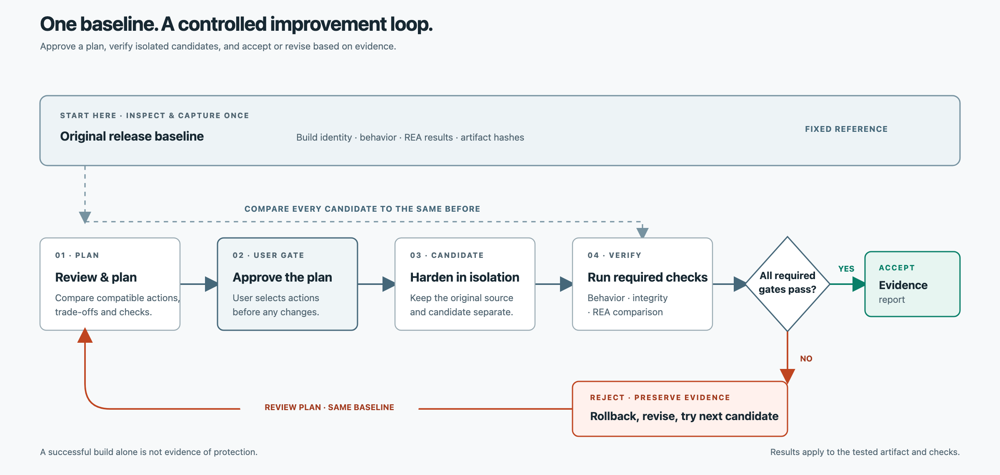

# Anti-REA: Application Hardening Against AI Reverse Engineering

**Anti-REA helps developers assess and harden applications against AI-assisted reverse engineering.** It compares a release artifact before and after supported defenses using [REA](https://github.com/morluto/rea), [Craft Anything](https://github.com/storytold/craft-anything), and applicable build, integrity, and behavior checks.

Use it with an AI assistant through the portable Skill or MCP server, or run the same workflows from the terminal. Anti-REA shows applicable options and trade-offs before execution, keeps the original project intact, and reports evidence from the candidate.

## Try it with an AI assistant

With the [Anti-REA Skill or MCP server](docs/harness-setup.md) available to your assistant, try:

> Inspect this app with Anti-REA. Show me what the release exposes, the compatible hardening options, and their trade-offs. Ask me to choose before making changes. Then verify the selected candidate against the same baseline and report the results.

Anti-REA presents evidence-backed options before execution and waits for the user's plan-bound choice. Available actions depend on the target and the adapters that can verify it.

## See example results

| Example | What Anti-REA did | Result |
|---|---|---|
| [Foodie Flutter app](examples/flutter-foodie/README.md) | Built an obfuscated Flutter 2.5.3 candidate and checked it with REA 6.8.0, an Android cold launch, and signature verification. | One accepted run. The [generated report](examples/flutter-foodie/effectiveness-report.md) shows BEFORE/AFTER artifact hashes and checks. Behavior coverage is one cold launch. |
| [Simple To-Do List](examples/simple-todo-list/README.md) | Captured a browser baseline, ran a REA summary, and prepared a BLA (Blind LLM Agents) plan for a small JavaScript app. | Plan is review-only; no candidate was executed. |

These examples show specific workflow results. They do not prove that an app is protected from all reverse engineering.

## How Anti-REA works



1. **Capture BEFORE once.** Anti-REA records the release artifact identity, hashes, and configured behavior evidence.
2. **Analyze in parallel.** REA and Craft Anything analyze the same snapshot when installed and compatible. Their versions, coverage, findings, and evidence are reported separately; an unavailable or failed engine remains visible.
3. **Plan an improvement.** Anti-REA maps findings to hardening actions its adapters support, with expected benefit, trade-offs, required checks, and rollback details. Unsupported findings are reported without inventing a fix.
4. **Approve the exact plan.** The user's decision is bound to the plan hash. No candidate changes happen before approval.
5. **Harden once in isolation.** Anti-REA applies the selected actions to a separate candidate; it does not automatically loop or add actions after approval.
6. **Measure AFTER.** Run the selected analysis engines and required build, integrity, and behavior checks against the candidate, comparing it with the same unchanged BEFORE baseline.
7. **Accept or revise.** Accept only when selected gates pass. Otherwise report rejected or partial evidence; another attempt requires a new plan and approval.

The report shows per-engine BEFORE/AFTER results without merging different scoring scales. A successful build alone is not evidence of protection.

## Supported analysis and hardening

The current adapter set covers selected JavaScript and BLA workflows, Flutter Android, WebAssembly, browser behavior, and Python dependency workflows. Actual actions depend on the project and verified adapter support; unavailable engines, unsupported findings, and incomplete checks remain explicit in the report. See the [CLI and adapter guide](docs/cli.md) and [acceptance audit](AUDIT.md) for current coverage and blockers.

Craft Anything contributes analysis evidence; its app reconstruction feature is not treated as hardening of the original artifact. REA and Craft Anything use different measures, so reports keep their findings separate instead of combining scores.

## Set up

Install the portable Skill in an application project with the standard community installer:

```sh
npx skills add tamkimd/anti-rea --skill anti-rea
```

Choose your agent and installation scope when prompted. See [harness setup](docs/harness-setup.md) for Codex, MCP, and other host options. To use Anti-REA directly from the terminal, install Python 3.11 or newer and the published PyPI package:

```sh
python3 -m venv .venv
. .venv/bin/activate
python -m pip install anti-rea
anti-rea doctor
```

Then inspect a project without executing it:

```sh
anti-rea inspect /path/to/project
```

Start the MCP server with `anti-rea mcp serve`. Set `ANTI_REA_STATE_DIR` to keep local workflow records outside the target project. See [CLI usage](docs/cli.md) for commands and options.

## Security and limitations

- Anti-REA keeps source and candidate files separate, but a private copy is not automatically a security sandbox.
- Supported Node and pinned REA/BLA lanes use the configured Docker profile by default. The Docker daemon is trusted, and staged output has no live disk quota.
- Host-run commands and project-provided browser tests may execute with the user's privileges. Run workflows only for projects and dependencies you trust.
- Keep state, raw reports, release artifacts, debug symbols, screenshots, caches, and secrets outside the source checkout.
- Blind LLM Agents (BLA) defenses and obfuscation can increase analysis effort; neither encrypts client code or prevents determined reverse engineering.

See [execution boundaries](docs/cli.md), the [release workflow](docs/release.md), and the [acceptance audit](AUDIT.md).

## Development

```sh
python -m unittest discover -s tests -p 'test_*.py'
python -m pip install -e '.[dev]'
ruff format --check .
ruff check .
```

## More

- [Optimization workflow](docs/optimization.md)
- [Flutter obfuscation workflow](docs/flutter-obfuscation-candidate.md)
- [Upstream tools and dependency limits](docs/upstream-integrations.md)
- [Harness setup](docs/harness-setup.md) · [compatibility matrix](docs/harness-compatibility.md)
- Examples: [Foodie](examples/flutter-foodie/README.md) · [Simple To-Do List](examples/simple-todo-list/README.md) · [Loopweek](examples/loopweek-flutter/README.md) · [Flutter Todo](examples/flutter-todo/REA-RESULT.md) · [TodoMVC React](examples/todomvc-react/README.md)
