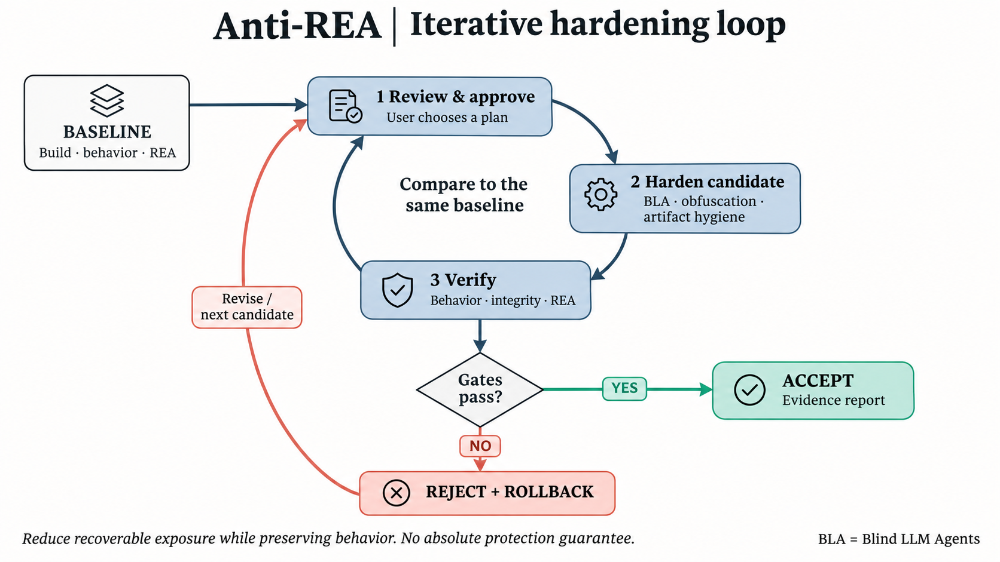

# Anti-REA: Application Hardening Against AI Reverse Engineering

**Assess and harden shipped software against AI reverse engineering with BLA defenses, evidence-based verification, and a Python CLI/MCP workflow.**

Anti-REA is an application-hardening and anti-reverse-engineering toolkit for developers who ship client-side software. It helps assess how much implementation detail AI reverse-engineering agents (REA) can recover, then evaluates defensive changes against the same baseline. Use its Python CLI, MCP server, or portable Agent Skill to inspect release artifacts, review BLA and other applicable hardening options, approve a plan, run isolated candidates, compare REA and behavior evidence, and retain acceptance or rollback records.

Anti-REA coordinates [REA](https://github.com/morluto/rea), a reverse-engineering analysis agent, with [BLA — Blind LLM Agents](https://github.com/qybaihe/bla), a counter-REA defense engine, and [tester-army/e2e](https://github.com/tester-army/e2e) for supported browser behavior checks. It provides a command-line interface, an [MCP](https://modelcontextprotocol.io/) server for compatible AI clients, and a portable Agent Skill for guided workflows. BLA's upstream project describes adversarial defenses such as decoys and analyzer-budget exhaustion; Anti-REA currently exposes only a limited subset through its adapter.

> **Project status: experimental.** Anti-REA is not ready for production use. Current adapters cover specific workflows and platforms; passing a fixture or build check does not prove that a real application is protected. Flutter Android obfuscation is held because pinned REA 6.8.0 cannot inspect the example application's unified Dart AOT snapshot. See the [acceptance audit](AUDIT.md) for evidence, open requirements, and blockers.

## Contents

- [Features](#features)
- [How Anti-REA hardens applications](#how-anti-rea-hardens-applications)
- [Quick start](#quick-start)
- [How the workflow works](#how-the-workflow-works)
- [Interfaces: CLI, MCP, and Agent Skill](#interfaces-cli-mcp-and-agent-skill)
- [Integrations and platform coverage](#integrations-and-platform-coverage)
- [Related reverse-engineering and application-protection projects](#related-reverse-engineering-and-application-protection-projects)
- [Security and execution model](#security-and-execution-model)
- [Known limitations](#known-limitations)
- [Development and verification](#development-and-verification)
- [Documentation and examples](#documentation-and-examples)
- [Frequently asked questions](#frequently-asked-questions)

## Features

- **Application and artifact discovery:** bounded, read-only inspection of project manifests and likely release artifacts.
- **Evidence-bound baselines:** capture an explicit BEFORE build and selected artifacts in a private project snapshot.
- **Plan-first hardening:** compare defensive options and review each action's mechanism, expected benefit, trade-offs, dependencies, verification, limitations, and rollback before choosing it.
- **BLA counter-REA defense:** run the supported BLA JavaScript candidate path and compare analysis and behavior evidence before accepting a change.
- **Additional release hardening:** create a source-map exclusion candidate for supported web release trees; platform-specific actions are offered only when their readiness and verification gates pass.
- **Behavior and exposure comparison:** compare available behavior checks and REA reports over defined source and candidate snapshots.
- **Acceptance and rollback records:** validate required evidence, reject failed or incomplete candidates, and retain authenticated candidate identity for rollback.
- **Three portable interfaces:** use the Python CLI, connect an MCP client, or follow the portable Agent Skill.
- **Pinned dependency preparation:** prepare supported upstream runtimes and hash-checked Python wheel locks in external caches.

Anti-REA is designed to make reverse engineering more difficult and less productive, not to promise that software can never be analyzed. Its current support is limited to the adapters and checks listed below.

## How Anti-REA hardens applications

The goal is to reduce recoverable implementation detail and raise the cost of analysis while preserving intended application behavior. Depending on the target and available evidence, a hardening plan may combine:

- **BLA counter-REA defenses:** BLA (Blind LLM Agents) is the upstream adversarial defense engine intended to make AI reverse-engineering agents waste analysis effort or return incomplete results. BLA describes techniques such as decoys and analyzer-budget exhaustion. Anti-REA pins BLA and currently exposes a limited single-JavaScript-file candidate workflow; it does not yet expose every upstream format or action.
- **Obfuscation:** transform code or symbols to make recovered logic harder to understand. The available adapter and verification requirements depend on the language and release format.
- **Release artifact hygiene:** exclude selected source maps from a private release-tree candidate and verify that unrelated files remain byte-identical. This candidate operation does not change hosting or deployment configuration.
- **Other platform controls:** platform-specific build settings and protections can be considered as adapters and evidence gates become available. Unsupported actions must remain blocked or unavailable rather than being presented as ready.

The workflow compares the original release with a selected candidate using REA and required behavior/integrity checks. REA results are a measurement of the configured analyzer, not proof that all reverse engineering has been prevented. No single technique makes client-side software impossible to inspect; sensitive secrets and authorization decisions should remain on trusted servers.

## Quick start

### Requirements

- Python 3.11 or newer.
- macOS or Linux for the verified local workflow. Other operating systems and individual adapters have narrower, separately documented support.
- Docker is required by default for supported pinned Node engine and baseline lanes; using the host runner is an explicit, unsandboxed choice. See [execution boundaries](#security-and-execution-model).

### Install from a source checkout

```sh
python3 -m venv .venv
. .venv/bin/activate
python -m pip install .
anti-rea doctor
anti-rea --help
```

To run the CLI directly from the checkout:

```sh
python3 interfaces/cli/anti_rea.py doctor
python3 interfaces/cli/anti_rea.py inspect /path/to/project
```

`doctor` checks required Python packages, safe filesystem operations, and any configured pinned runtimes. It does not install dependencies or guarantee that optional engines and providers are available.

### Inspect a project

```sh
anti-rea inspect /path/to/project
```

Discovery does not execute the inspected project. It records bounded artifact and manifest information, reports excluded dependency/generated directories, and identifies some likely worker and framework hints. A hint is not proof of runtime use, reachability, or a complete build graph.

### Run the MCP server

```sh
anti-rea mcp serve
```

The package also installs the `anti-rea-mcp` entrypoint. Set `ANTI_REA_STATE_DIR` to choose where the local MCP server stores workflow state. Long-running MCP operations can return a run ID for polling. The server records a decision supplied by its client; it cannot establish that the decision came from a human.

## How the workflow works



The diagram shows the iterative hardening model. The BEFORE baseline is captured once and stays fixed while candidate configurations are compared. Each candidate moves through a plan review, hardening, and verification cycle; passing candidates can be accepted, while failed candidates are rejected and rolled back.

1. **Check readiness and inspect** with `anti-rea doctor` and `anti-rea inspect`.
2. **Capture the BEFORE baseline once** using an explicit build command, artifact list, and applicable behavior or REA checks. Preserve it as the comparison point for every candidate in the run.
3. **Review and approve a plan.** Inspect the expected benefits, costs, compatibility, verification, limitations, and rollback steps. The user's decision binds to the exact plan hash; a blank selection rejects the plan.
4. **Harden an isolated candidate** using only selected, supported actions. Examples include the integrated BLA JavaScript path and source-map release hygiene.
5. **Verify against the same baseline** using the checks required by the plan, such as BLA invariants, behavior, REA comparison, performance, and artifact integrity.
6. **Apply the gate result.** Accept a candidate only when all required checks pass. Otherwise reject it and retain rollback evidence.
7. **Continue only within the approved scope.** In a bounded approved search, roll back a failed candidate and evaluate the next approved candidate against the unchanged baseline. If a new action or broader scope is needed, prepare a revised plan and obtain a new explicit decision.

The loop is a workflow model, not a claim that every Anti-REA lane automatically retries candidates. Ordinary plan execution handles its selected action set; the optimization interface supports bounded approved BLA JavaScript candidate searches with separate review and confirmation gates. See the [optimization workflow](docs/optimization.md).

Common commands include `baseline`, `recommend`, `choose`, `execute-plan`, `status`, `report`, `cancel`, and `rollback-candidate`. See the [CLI guide](docs/cli.md) for arguments, outputs, and exit codes.

## Interfaces: CLI, MCP, and Agent Skill

### Command-line interface

The CLI is the direct terminal interface for project inspection, baseline capture, recommendations, decisions, execution, reports, cancellation, and rollback. Results are machine-readable JSON, with interactive prompts used for explicit user choices. Start with:

```sh
anti-rea --help
anti-rea registry
```

### MCP server

The MCP server exposes shared core operations to compatible AI clients, including project inspection, plan creation, decisions, asynchronous run tracking, evidence, and reports. MCP availability alone does not imply that a given host or client has been tested end to end.

### Portable Agent Skill

The packaged Skill guides an assistant through discovery, baseline, recommendation review, explicit selection, execution, and evidence-based reporting. It uses CLI or MCP capabilities available in the host. See [harness setup](docs/harness-setup.md), the [manual harness fallback](docs/harness-fallback.md), and the [compatibility matrix](docs/harness-compatibility.md).

## Integrations and platform coverage

| Area | Implemented workflow | Evidence boundary |
|---|---|---|
| Project discovery | Bounded manifest and artifact inventory, with selected JavaScript framework and worker hints. | Hints are path- or declaration-based; they do not establish a build graph, code reachability, or runtime behavior. |
| BLA counter-REA defense | Pinned BLA 1.6.3 adapter can transform one selected JavaScript file into an isolated candidate and run BLA's invariant verifier. | Anti-REA's adapter does not yet expose the full upstream BLA format/action matrix. Owned fixture runs are not evidence of protection for another application. |
| JavaScript release hygiene | Create a private build-tree candidate omitting one selected source map and verify the other files remain unchanged. | This does not change deployment configuration or prove which assets a production server exposes. |
| Obfuscation | Flutter Android candidate workflow is documented and gated on a supported AOT inspection. | The pinned REA snapshot gate currently blocks Flutter candidate execution; no Flutter obfuscation result is available. |
| REA analysis | Pinned REA CLI/MCP runtime, selected JavaScript analysis, and comparable BEFORE/AFTER summary flow. | Finding counts measure scanner output. They are not a measure of protection by themselves. |
| Browser behavior | Pinned e2e checks for supported fixture-compatible web configurations. | Project browser configuration and test code may execute with host privileges; this is not general framework coverage. |
| Flutter Android | Android release baseline capture, readiness checks, and limited hash-bound example analysis and emulator behavior reports. | Pinned REA 6.8.0 reports the example's unified Dart AOT snapshot as unsupported. No obfuscated candidate has been run. |
| WebAssembly | Bounded import/export metadata inspection and a Node compile probe without module instantiation. | Does not prove host bindings, runtime use, or module behavior. |
| Python dependencies | PEP 751 lock inspection and isolated, hash-checked wheel preparation. | Experimental pip support; tested installation and reuse are on macOS ARM64 only. |
| Harness support | CLI, MCP, and portable Skill entrypoints. | A full approval-to-acceptance workflow has not been verified across representative harnesses. |

The checked-in Python 3.11 wheel matrix includes macOS ARM64, Linux glibc x86_64/ARM64, and Windows x86_64 candidates. pip target selection passed on those targets, but Linux and Windows installation remain unverified. The Android AOT gate remains deliberately held until the pinned REA inspection can pass and acceptance evidence can be collected.

### Related reverse-engineering and application-protection projects

Anti-REA is an evidence and orchestration layer; it does not replace the specialized tools it integrates with or the platform's own release hardening:

| Project | Role in the ecosystem | Anti-REA relationship |
|---|---|---|
| [REA (Reverse Engineer Anything)](https://github.com/morluto/rea) | Uses AI-agent workflows to analyze applications and release artifacts. | Integrated as the analysis engine for supported, pinned workflows. |
| [BLA (Blind LLM Agents)](https://github.com/qybaihe/bla) | Provides adversarial defenses intended to reduce the effectiveness of AI reverse-engineering agents. | Integrated as a defensive engine; Anti-REA currently exposes a limited single-JavaScript-file candidate workflow, not BLA's full upstream format matrix. |
| [Android R8](https://developer.android.com/topic/performance/app-optimization/enable-app-optimization) | Android's code shrinker and optimizer can also obfuscate class, field, and method names. | Relevant Android release hardening technology, but no general R8 adapter is currently implemented in Anti-REA. |
| [ProGuard](https://github.com/Guardsquare/proguard) | Java bytecode shrinker, optimizer, and obfuscator. | Related ecosystem tool; not currently wired as an Anti-REA execution adapter. |

This distinction matters: R8/ProGuard-style name obfuscation and BLA's counter-REA defenses address different parts of the exposure problem. Anti-REA's goal is to select applicable measures and compare their effect with analysis and behavior evidence, while keeping unsupported integrations visibly out of scope.

For Python projects with a root-level PEP 751 `pylock.toml`, inspect or prepare dependencies with:

```sh
anti-rea inspect-python-dependencies /path/to/project
anti-rea prepare-python-dependencies /path/to/project --cache-dir /path/outside/project/anti-rea-cache
anti-rea prepare-python-dependencies /path/to/project --cache-dir /path/outside/project/anti-rea-cache --offline
```

Preparation supports exact-version, unconditional packages with SHA-256-pinned wheel sources. `--offline` checks an existing prepared cache entry without installing packages. More details and limitations are in [upstream integrations](docs/upstream-integrations.md).

## Security and execution model

Anti-REA stores baselines and candidates separately from the original project, but a private copy is not automatically a security sandbox.

- Supported Node/npm/npx baseline commands and pinned REA/BLA engine operations use the configured Docker profile by default. The Docker daemon is trusted.
- Docker Desktop does not enforce a live writable-disk quota for staged output. Some output size checks occur only after a process exits.
- `ANTI_REA_NODE_SANDBOX=host` explicitly selects an unsandboxed host runner. Host-run commands use the user's OS privileges.
- Project-provided e2e/browser configuration and tests can execute with host privileges, even when they operate on a private snapshot.
- Snapshots omit selected dependency/generated directories and discovered symlinks. A command that relies on omitted inputs may fail. Host-run scripts can write outside a snapshot using absolute paths, `..`, or embedded code.
- Build commands, project tests, and installed upstream tools execute code. Only run workflows for projects and dependencies you trust.
- Store raw reports, APK/AAB files, symbols, screenshots, caches, and run state outside the source checkout. Keep secrets and private artifacts out of version control.
- Evidence hashes and record relationships are validated, but every evidence producer and local state-store owner is not authenticated.

The [release guide](docs/release.md) documents wheel integrity and detached Ed25519 signing. Signing uses an externally managed key; this repository does not configure a trusted release identity.

## Known limitations

- Anti-REA is experimental and does not meet all mandatory release acceptance criteria.
- BLA, obfuscation, and source-map controls increase analysis cost or reduce selected exposure; they cannot guarantee that a determined analyst will not recover application behavior or logic.
- Fixture tests establish tool behavior on those fixtures only. Real application protection needs comparable BEFORE/AFTER evidence, independent behavior checks, integrity verification, and claims supported by those results.
- Flutter Android AOT obfuscation is blocked at the pinned REA snapshot-inspection gate. No Flutter candidate or protection result is available.
- Discovery is bounded and heuristic; it does not infer complete build graphs, trust boundaries, runtime reachability, or assets hidden in excluded directories.
- Supported BLA and source-map workflows cover specific JavaScript cases, not every framework or deployment pipeline.
- Platform adapters, durable workers, deployment rollback, representative harness verification, and trusted release signing remain incomplete.
- Linux and Windows lock-wheel selection does not equal a tested runtime installation on those systems.

## Development and verification

Create a Python 3.11+ environment and install the package as described in [Quick start](#quick-start). Run the repository test suite with:

```sh
python -m unittest discover -s tests -p 'test_*.py'
```

The latest recorded CPython 3.11.18 full-suite run passed **444 tests with 28 optional skips**. This is repository test evidence, not production readiness or proof of real-application protection. See the [full-suite record](verification/anti-rea-python-dependency-prepare-full-suite-20261102.json), [private package verification](verification/anti-rea-python-dependency-prepare-package-20261102.json), and [acceptance audit](AUDIT.md).

The wheel includes the portable Skill, schemas, pinned upstream locks, integration adapters, and owned fixtures under its installation data directory. Locate the installed package data with:

```sh
python -c 'import sysconfig; print(sysconfig.get_path("data") + "/share/anti-rea")'
```

## Documentation and examples

- [CLI reference](docs/cli.md)
- [Upstream tools and dependency limits](docs/upstream-integrations.md)
- [Flutter obfuscation candidate workflow](docs/flutter-obfuscation-candidate.md)
- [Optimization workflow](docs/optimization.md)
- [Workflow schema versioning](docs/schema-versioning.md)
- [Harness setup](docs/harness-setup.md)
- [Harness compatibility matrix](docs/harness-compatibility.md)
- [Loopweek Flutter example](examples/loopweek-flutter/README.md): hash-bound Android analysis and a limited emulator behavior report; no transformation comparison or protection claim.
- [Flutter Todo report](examples/flutter-todo/REA-RESULT.md): separate, limited-scope real application report.
- [TodoMVC React example](examples/todomvc-react/README.md): read-only plan review; no action was executed.
- [Acceptance audit](AUDIT.md): requirement-by-requirement status, evidence, and blockers.

## Frequently asked questions

### Does Anti-REA automatically protect my application?

Anti-REA is built to help harden applications against reverse engineering, including AI REA tools, but it does not silently modify a project. It presents supported actions for review and runs only the selected plan. Claims about reduced exposure require comparable REA and behavior evidence from the target application; fixture results do not establish protection for your app.

### What is BLA and how does Anti-REA use it?

BLA means **Blind LLM Agents**. It is an upstream defensive engine that aims to make AI reverse-engineering agents less effective using adversarial techniques. Anti-REA pins BLA and currently supports a limited single-JavaScript-file candidate workflow with invariant verification. The full BLA upstream format and action coverage is not yet exposed by Anti-REA.

### Can Anti-REA guarantee that REA cannot recover my code?

No. Obfuscation and BLA-style adversarial defenses can increase analysis cost or reduce what a particular analyzer recovers, but they are not encryption and cannot guarantee that client-side logic remains secret. Keep credentials, keys, and security-critical authorization on trusted services.

### Which programming language and interfaces does Anti-REA use?

The shared core and CLI are Python-based and require Python 3.11 or newer. The project also provides an MCP server and a portable Agent Skill for compatible assistants.

### Is Flutter Android obfuscation supported?

The repository contains Flutter Android baseline and readiness workflows. The obfuscation candidate workflow is held because pinned REA 6.8.0 cannot inspect the example's unified Dart AOT snapshot. No transformed Flutter candidate has been accepted.

### Does Docker make every command safe to run?

No. The Docker profile applies only to documented lanes, trusts the Docker daemon, and has a staged-output disk-quota limitation. Host overrides and project-provided browser tests execute with host privileges. Review the [security and execution model](#security-and-execution-model) before running code.

### Where can I see current support and blockers?

Check the [capability table](#integrations-and-platform-coverage), the [harness compatibility matrix](docs/harness-compatibility.md), and the [acceptance audit](AUDIT.md). Those records distinguish implemented behavior from partial or unverified support.
